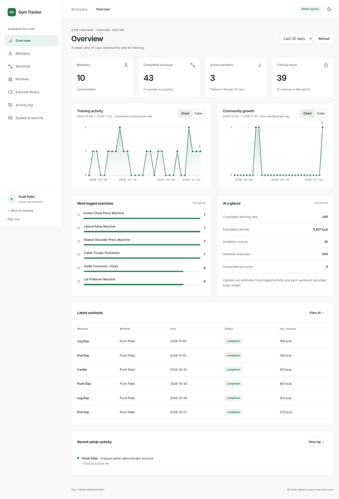

# Gym Tracker administration

Open `/admin` on the same origin as Gym Tracker. Locally: `http://localhost:5173/admin`.
The normal login accepts either email or username. An authenticated administrator also sees an **Admin portal** link in the training header.

## Available tools

| Section | Functionality |
|---|---|
| Overview | Real database counts, 7/30/90/365-day training and registration charts, active members, training hours, estimated calories, popular exercises, recent workouts and administrative activity. Charts include accessible table views. |
| Members | Search and paginate accounts; create members; view training summaries; edit display names; suspend/resume access; sign out all devices. The owner can grant/revoke admin access and create additional administrators. |
| Workouts | Search by workout, date, member name or email; filter active/completed; inspect sets and cardio; edit completed sessions and recalculate totals; delete a completed session after confirmation. Active sessions remain controlled by their member. |
| Routines | Search and filter; inspect exercises and owners; change names, notes and targets; add/remove exercises; archive or restore routines. |
| Exercise library | Search shared/custom entries; create shared exercises; edit muscles, MET, rest, equipment, bodyweight/timing/distance flags and calorie models; archive/restore. Admin edits survive catalog refreshes. |
| Activity log | Searchable, paginated record of administrative mutations, with actor, action, target, timestamp and a summary. No password or recovery-token values are recorded. |
| System & security | Database connectivity/latency, process uptime, runtime, calculation/catalog version, active-session index and SMTP configuration status. Change your own admin password and revoke older sessions. |

CSV export is explicitly **the current page**, not a full database backup. Secrets and authentication hashes are never included. A suspended account retains its training records. Permanent account deletion is not offered in administration, and the owner account cannot be suspended, demoted or deleted through the app.

## Account setup

The requested `punitpatel` owner account was created for `punitpatidar9644@gmail.com` in the configured database on November 2, 2026. The provided password is stored as a bcrypt hash only; it is not embedded in source, frontend assets or startup logic. Browser sign-in was verified. You can change the initial password under **System & security**.

For another environment, the explicit `npm run admin:create` command accepts `ADMIN_USERNAME`, `ADMIN_EMAIL` and `ADMIN_PASSWORD` from process environment variables, alongside `MONGODB_URI`. Supply secrets through your terminal/secret manager and remove the environment variables afterward. The command creates an account or promotes the existing matching email while preserving its training data. It never runs automatically and refuses a username already belonging to a different email.

Administrator-created members do not receive an automatic email or fabricated email verification. Their initial password must be communicated by the administrator. No email was sent during implementation or testing.

## Implementation and deployment

- All `/api/admin/*` endpoints run `requireAuth` and `requireAdmin`; the role and suspension status are read from MongoDB on every request. The public signup/profile APIs cannot assign roles or owner status.
- Usernames are unique when present. Existing users without a username remain valid and retain email login. Existing users default to the member role.
- Access changes increment the session version. Suspensions block existing tokens and future login. Owner status can only be provisioned through the explicit server-side setup command.
- Records use revision checks and optimistic concurrency. A stale edit receives a conflict instead of overwriting a newer edit. Completed-workout corrections preserve recorded body weight and use the shared calculation engine.
- Admin API responses use `Cache-Control: no-store`. The frontend does not write admin data to its offline cache. Normal API authentication uses the existing httpOnly cookie.
- The portal uses the existing component styles and chart library. Its JavaScript/CSS are lazy-loaded; no extra component framework was needed.
- Deploy client and API together, with the same `JWT_SECRET`, database configuration and HTTPS cookie setup used by the training app. Both the Express server and the Vercel API entry point mount the admin routes. The existing in-memory rate limiter remains per process.

## Verification

`npm test` passes 57 tests: 14 unit/worker tests, 21 isolated database/API tests and 22 React interaction tests. Admin cases cover unauthorized access, username login, protected-owner rules, suspension, role restrictions, account creation, stale edits, recalculation, catalog preservation, audit events, password changes, pagination and dashboard-to-table navigation.

Browser checks verified owner sign-in, dashboard charts at desktop and narrow widths, protected member controls, the live workout list and opening a completed-workout editor without modifying its data. Database/API read checks also covered routines, exercises and system health. Only the requested admin account was provisioned; existing training records were not changed for testing.

